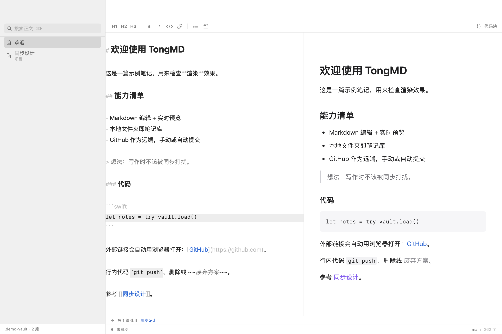
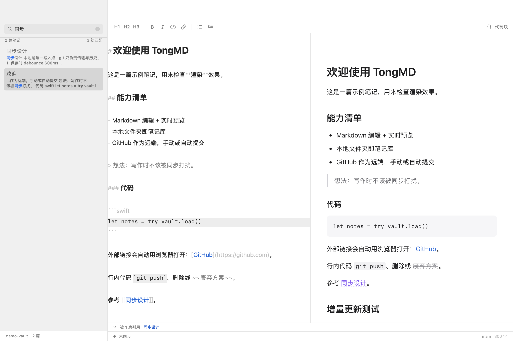

# TongMD

macOS 上的 Markdown 笔记 App：笔记就是文件夹里的 `.md` 文件，GitHub 当远端和版本库。没有云服务、没有私有数据库，换台电脑 `git clone` 就能接着写。

当前是可用的骨架（M1 + M2 + 编辑体验）：本地写作、带语法高亮的编辑器、全文搜索、双链、文件夹、实时预览、git 同步、冲突保护。刻意没做的部分见文末「已知限制」。



## 构建与运行

只依赖 Command Line Tools（不需要完整 Xcode、不需要开发者账号）：

```bash
./scripts/build-app.sh          # release，产物 build/TongMD.app
./scripts/build-app.sh debug    # debug，自检可用
open build/TongMD.app

./scripts/build-dmg.sh          # 打包可安装的 build/TongMD-<版本>.dmg
```

`build-dmg.sh` 会重新构建 release、组装「App + Applications 快捷方式」、压缩成 UDZO 映像，然后自动挂载做一次冒烟检查（应用在不在、图标在不在、签名能不能过），最后打印 SHA-256。

DMG 挂在名为 `TongMD` 的卷上，打开后把 App 拖进 Applications 即可。因为没做公证，第一次从 Finder 双击如果被拦，右键 →「打开」；如果是从网络传过来的文件，也可以：

```bash
xattr -dr com.apple.quarantine /Applications/TongMD.app
```

App 图标由 `scripts/make-icon.swift` 用代码画出来（改颜色或文字直接改那个文件），`scripts/make-icns.sh` 烘成 `.icns`，构建时自动生成：


## 首次使用

1. 打开 App，点「选择本地文件夹…」选一个空目录（比如 `~/Notes`），或者
2. ⌘, 打开设置，填仓库地址（`https://github.com/you/notes.git`）+ Personal Access Token，点「克隆仓库到此…」。
3. 之后：左边是文件树，中间写作，右边预览。⌘N 新建，⌘S 保存，**⇧⌘S 同步到 GitHub**。

Token 建议用 fine-grained PAT，只勾选目标仓库的 `Contents: Read and write`。它存在系统钥匙串里，调用 git 时通过 `http.extraheader` 临时传入，不会落到 `.git/config` 或磁盘上的明文文件。

## Token 怎么拿

设置页（`⌘,`）里的 Token 就是 GitHub 的 Personal Access Token，用来让 git 能往你的仓库推东西。三条路，按省事程度排：

**方式一：用 gh CLI（推荐）**

```bash
gh auth login    # 选 GitHub.com → HTTPS → Login with a web browser
```

登录一次后回到 App，设置页点「**从 gh 导入**」，Token 会自动填入钥匙串；再点「**验证连接**」确认能读到仓库。Token 失效时重新跑一次 `gh auth login` 再导入即可。

**方式二：网页创建 fine-grained token**

1. 设置页点「**打开 Token 页面**」（等价于 <https://github.com/settings/personal-access-tokens/new>）
2. Repository access 选 `Only select repositories`，勾选你的笔记仓库
3. Permissions → Repository permissions → `Contents` 设为 **Read and write**
4. Generate token，复制 `github_pat_…` 粘到设置页

**方式三：SSH 地址，完全不用 Token**

本机已经有 GitHub SSH key 的话，仓库地址填 `git@github.com:用户名/仓库.git`，Token 留空，git 会走 ssh-agent。

「验证连接」只做 `git ls-remote --heads`，是只读探测，不会改动仓库。

### 常见错误对照

| 报错 | 含义 | 处理 |
| --- | --- | --- |
| `401 Bad credentials` / `Authentication failed` | Token 无效、过期或被撤销 | 重新 `gh auth login` 后导入，或新建 token |
| `403 Write access to repository not granted` | Token 有效，但只有读权限 | fine-grained token 把 Contents 改成 **Read and write**；用 gh 的话运行 `gh auth refresh -s repo` |
| `Failed to connect ... port 443` | 网络没通，通常是没有走代理 | 确认代理软件在运行；App 会自动读取 macOS 系统代理 |
| `Error in the HTTP2 framing layer` | 代理链路对 HTTP/2 不友好 | App 已强制 HTTP/1.1，一般不会再出现 |

钥匙串提示：App 是 ad-hoc 签名，换了构建之后 macOS 可能弹一次「允许访问钥匙串」，选 **始终允许**，否则 Token 存不住。

Token 会在使用前校验格式（必须以 `ghp_` / `github_pat_` 等开头）。如果粘贴进来的是十六进制字符串（有些工具会这么显示 Token），App 会自动还原；格式不对会立刻提示，而不是等到同步时才报一个看不懂的错。

## 编辑器

写的时候不用背语法：

- **结构直接可见**：标题会变大变粗、`**粗体**` 显示成粗体、行内代码换成等宽加浅底、代码块整段带底色，`#`、`*`、反引号这些记号被压暗，你看的是结构而不是符号。
- **格式条**：编辑区上方一排按钮（H1/H2/H3、粗体、斜体、行内代码、链接、列表、引用、代码块），点一下就给选区套上格式，再点一下取消。
- **快捷键**：`⌘B` 粗体、`⌘I` 斜体、`⌘K` 链接、`⇧⌘C` 行内代码、`⇧⌘K` 代码块、`⌘1/2/3` 标题、`⌘0` 正文、`⇧⌘L` 列表、`⇧⌘B` 引用。
- **智能续行**：列表里回车自动接上 `- `，有序列表自动递增编号，引用自动接 `> `；空项目再回车就退出列表。
- **速查**：`⇧⌘/`（或「视图 → Markdown 速查」）打开一张语法表，忘了就瞄一眼。
- **字号**：`⌘+` 放大、`⌘-` 缩小、`⌘0` 回到 15pt；也可以点格式条右侧的两个字号按钮。范围 11–24pt，编辑器、标题和预览一起缩放，选择会记住。

中文输入法组字期间会跳过重绘，不会打断候选词。文档超过 8000 字时，按键只重排光标所在段落。

段落里的单个换行会原样保留（严格 Markdown 会合并成空格）——记笔记时这更符合直觉。从 JIRA/需求系统粘过来的 `<br>`、`<p>`、`&nbsp;` 会被转换成换行、段落和空格；写在代码块或行内代码里的则保持字面量。

## 纯文本 .txt

`.txt` 和 `.md` 一样进侧栏、进搜索、能拖能改能同步，但按**纯文本**对待：

- **编辑器**：等宽字体，不做 Markdown 高亮，隐藏格式条，回车不会自动续列表——避免在日志里被自动插 `- `
- **预览**：直接按原文渲染，保留空行和缩进，`#`、`-` 不会被当成标题和列表
- **新建**：`⌥⌘N`，或工具栏 `+` / 右键菜单里的「新建文本文件」

适合放日志、命令记录、配置片段这类不需要排版的文本。

## 文件夹与移动

侧栏就是笔记库的目录树，目录在前、笔记在后，点目录名展开/收起。

- **新建文件夹**：`⇧⌘N`、工具栏 `+`，或在**任何地方右键**（空白处 / 笔记 / 文件夹）都有「新建文件夹」。位置规则固定为：右键的文件夹 > 当前选中的文件夹 > 笔记库根目录，弹窗里会写着「将创建在 …」。
- **移动**：直接把笔记（或整个文件夹）拖到目标目录上，拖到哪个目录哪个目录会**高亮**；根目录那一行也是拖放目标。也可以右键 →「移动到」→ 选目录。
- **多选**：⌘ 点击或 ⇧ 点击选多个（文件夹和笔记可以混选）。选中多个后**拖动其中任意一个，整批都会跟着走**，右键「移动到」同理。
- **重名不覆盖**：目标里已有同名文件时自动变成 `名字 2.md`，不会悄悄覆盖。
- **选中反馈**：文件夹和笔记一样会高亮，多选时同时高亮。
- **改名 / 删除**：右键 →「重命名…」/「移到废纸篓」。删除走系统废纸篓，可恢复。
- 目录可以整体拖动，但不能拖进自己或自己的子目录（会被忽略）。

移动就是文件系统上的移动，git 会把它记成「删除 + 新增」；因为双链是按标题解析的，移动后链接和反向链接仍然有效。

## 标签页

打开的笔记会进入编辑区上方的标签栏，点标签切换，点 × 或 `⌘W` 关闭；标签右键可以「关闭其它标签页」。

`⌘W` 被标签页占用（这是浏览器的习惯）；要关窗口用左上角的红色按钮，或 `⇧⌘W`。

标签页之间共享同一个编辑器视图，切换时会正常保存当前这篇，所以不会丢内容；但每篇的撤销历史是独立的（切回来不能撤销上一段的操作）。

## 文件监听

笔记库用 FSEvents 监听（0.8 秒延迟 + 0.6 秒合并），以下情况会自动刷新侧栏和当前笔记：

- 在 VS Code / Obsidian / Finder 里改了文件
- `git pull` 拉下来新内容
- 外部新建/删除/重命名文件

正在编辑且有未保存内容时不会覆盖编辑器里的文字，只刷新列表。

## 附件

在编辑器里**粘贴图片**，会自动存到当前笔记所在目录的 `assets/` 下，并插入相对路径 ``。同名文件自动加序号，文件名里的空格和斜杠会转成连字符。

设置页的「附件与体积」会显示附件数量、总体积和最大的那个文件；单个超过 10MB 或总量超过 100MB 时会提示（git 仓库会跟着膨胀，必要时上 Git LFS）。

## 搜索与双链



**全文搜索**：`⌘F` 聚焦侧栏搜索框。

- 搜正文，不只是标题；中文任意长度都能命中，"同步"这种两字词也可以。
- 空格分隔多个关键词是 AND 关系，排序规则是「标题命中 > 正文命中次数」。
- 结果里显示命中片段（关键词高亮）和总命中处数。

没用 SQLite FTS5 是有意的：`unicode61` 不分中文词，`trigram` 又要求至少 3 个字，两字词直接搜不到。笔记库通常只有几 MB，对内存里的正文做大小写不敏感匹配语义最准、实现也最简单；等库到几十 MB 再换倒排索引。

**双链**：

- 写 `[[笔记名]]` 或 `[[笔记名|显示文字]]`，`[[项目/计划]]` 可以指向子目录。
- 预览里点击即跳转；目标不存在会问一句，确认后按这个名字新建（子目录自动创建）。
- `⌘[` 返回上一篇。
- 底部显示「被 N 篇引用」，点引用方的标题直接过去。

## 结构

## 同步语义（有意设计成不对称）

| 动作 | 何时发生 |
| --- | --- |
| 写盘 | 输入停止 600ms 后 debounce 保存；失焦、退出、切换笔记时强制保存 |
| `git commit` | 保存后再等 3s；可在设置里关掉 |
| `git pull --rebase` + `git push` | 只有手动 ⇧⌘S |

只自动提交、不自动推送，是为了避免写两句话就在 GitHub 上多一条提交记录，也避免网络抖动时把界面卡住。

**代理**：git 不会使用 macOS 的「系统代理」，只认环境变量和 git config。App 启动网络操作时会用 `CFNetworkCopySystemProxySettings` 读出系统代理，显式传给 git（支持 HTTP/HTTPS/SOCKS）；设置页的「同步状态」里会显示当前是「系统代理 127.0.0.1:7897」还是「直连」。如果代理软件的规则把 `github.com` 分流到直连，仍然会超时，需要在代理里给它加规则。

所有网络操作都强制 `-c http.version=HTTP/1.1`。某些代理或透明网关下，Apple Git 的 HTTP/2 会直接报 `Error in the HTTP2 framing layer`（表现为「同步不了」但其实连认证都没走到），HTTP/1.1 则正常；笔记仓库体量小，这点性能差别可以忽略。

git 的原始报错会被翻译成能直接行动的中文：`Authentication failed` → 提示 Token 无效并给出「从 gh 导入」，`Repository not found` → 提示去勾选 fine-grained 的仓库权限，DNS 失败 → 提示检查代理/VPN。

冲突处理的原则是**永不吞掉本地内容**：

- 拉取失败且卡在 rebase 中途 → 自动 `rebase --abort`，本地版本原样保留；
- 然后照常提交、尝试推送，推送失败会在状态栏说明；
- 状态栏提示「远端有冲突，已保留本地版本」，自己去终端 `git pull --rebase` 解决。

## 结构

```
Sources/TongMD/
  TongMDApp.swift   入口、菜单命令
  RootView.swift    三栏界面、状态栏
  EditorView.swift  NSScrollView + NSTextView 编辑器、WKWebView 预览
  FormatBar.swift   编辑区上方的格式条（走响应者链调动作）
  MarkdownCheatSheet.swift  语法速查面板
  AppModel.swift    状态中枢：扫描、读写、debounce、同步编排
  Git.swift         进程调用系统 git（clone/pull/commit/push）
  Markdown.swift    轻量 Markdown → HTML，本地图片内联成 data URI
  Keychain.swift    PAT 存取
  Search/
    SearchEngine.swift  内存全文检索（多关键词 AND、片段、排序）
    WikiLinks.swift     [[双链]] 解析与反向引用判定
  Editor/
    MarkdownTextView.swift          编辑器子类：拦截回车、暴露格式化动作
    MarkdownSyntaxHighlighter.swift 按行/按段着色，记号压暗
    TextActions.swift               包裹、行前缀、智能续行的实现
  SelfTest.swift    开发期自检（DEBUG）
```

## 自检

```bash
./scripts/build-app.sh debug
./build/TongMD.app/Contents/MacOS/TongMD --self-test
```

会在 `.selftest/` 里建一个本地裸仓库，跑一遍：初始化、提交、推送、克隆、双端同步、冲突回退，外加 Markdown 渲染断言。不需要网络和 GitHub 账号。

调试用的两个额外入口（仅 debug 构建）：

```bash
# 指定笔记库启动
open -n build/TongMD.app --args --vault "$PWD/.demo-vault"

# 离屏渲染界面截图，并断言「输入后预览确实增量更新了」
./build/TongMD.app/Contents/MacOS/TongMD --vault "$PWD/.demo-vault" --snapshot /tmp/shot.png
```

`--snapshot` 会输出整窗首帧 `shot.png` 和预览区 `shot-preview.png`，并打印预览 DOM 的长度变化；如果增量更新没生效会返回非 0。注意 `NSView.cacheDisplay` 抓不到 JS 更新后的 WKWebView 图层，所以预览必须用 WebKit 自己的 `takeSnapshot`。

## 输入延迟相关的取舍

这些是踩过的坑，改回去之前先想清楚：

- **预览只替换 `body.innerHTML`，不整页 `loadHTMLString`**。整页重载会重建 DOM、重置滚动位置，每次停顿闪一下；现在只有切换笔记才走整页加载。
- **本地图片按「路径 + mtime」缓存 base64**。否则每敲一次字都要把图片重新读一遍再编码，大图会直接把主线程卡住。
- **语法高亮不能写在 `NSTextStorage` 的 `didProcessEditing` 里**。在那里改属性会破坏 TextKit 的字形替换缓存，表现为 ASCII 正常但整段中文不显示（数据没丢，只是不画）。现在把上色推迟到下一个 runloop tick，并且有字形断言兜底。
- **输入法组字期间绝不碰缓冲区**：组字时回车是「确认候选词」，不能触发智能续行；延迟上色也要跳过，等提交后再补一次。另外 `updateNSView` 在 `hasMarkedText()` 时不做整段替换，否则会吞掉正在输入的字符。这三处都会表现为「打字丢字 / 莫名多一个换行」。
- **`git` 调用一律降频**：保存不触发 `git status`，自动提交 debounce 8 秒且有防重入，避免连续写作时反复起进程。切换笔记、同步、回到前台时才刷新「几项改动」。

## 已知限制

- 没有斜杠命令（`/h1` 那种）、没有自动补全，格式还是靠快捷键和按钮。
- 双链没有输入 `[[` 时的自动补全，得自己记文件名（或从预览里点过去）。
- 排序固定为「目录在前、按名称」，不能手动排。
- 只有单窗口 + 标签页，没有多窗口（同一份 AppModel，多窗口会互相干扰）。
- 附件（图片）直接进 git，仓库会随图片增长；大图会拖慢 clone。
- 外部改动靠「切回 App 时比对 mtime」发现，不是 FSEvents 实时监听。
- 只做了 ad-hoc 签名，没有 Developer ID 公证；换机器传来时会被 Gatekeeper 拦一次（见上面的 `xattr` 命令）。

## 下一步优先级建议

1. 侧栏多选 + 批量移动、拖拽时高亮目标目录
2. FSEvents 监听 + 多窗口/标签页
3. 附件目录约定（`assets/`）与体积提示
4. 菜单栏速记（全局快捷键 → 追加到当天日记）
5. 搜索结果高亮定位（跳到笔记后滚动到命中处）
